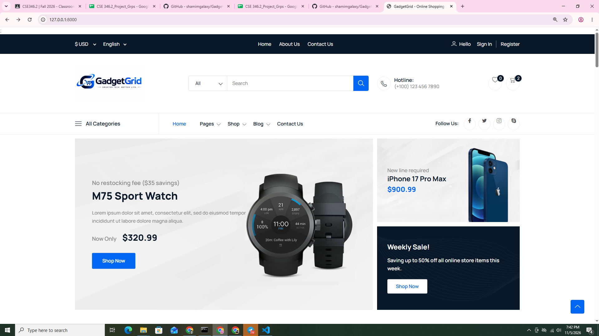

# GadgetGrid: Gadget E-commerce Platform

> A web-based e-commerce application for browsing, comparing and buying gadgets online, with an administrator dashboard for managing products, categories, stock and orders.

**Course:** CSE 346.2, Southeast University
**Group:** 2
**Instructor:** _[Askek Seum]_

---

## Table of Contents

1. [Problem Statement](#problem-statement)
2. [Objectives](#objectives)
3. [Features](#features)
4. [Tech Stack](#tech-stack)
5. [System Architecture](#system-architecture)
6. [Database Design](#database-design)
7. [Installation Guide](#installation-guide)
8. [Project Structure](#project-structure)
9. [Routes Overview](#routes-overview)
10. [Testing](#testing)
11. [Screenshots](#screenshots)
12. [Development Status](#development-status)
13. [Future Enhancements](#future-enhancements)
14. [Team](#team)

---

## Problem Statement

Buying gadgets from small local shops is often slow and unorganized. Customers have no easy way to compare products, check availability, or track their orders, and shop owners rely on manual records for stock and sales.

## Objectives

- Give customers a fast, clean way to browse gadgets by category and view full product details.
- Let customers add items to a cart and place orders online.
- Give administrators a single dashboard to manage products, categories, stock and orders.
- Build the system on secure authentication, role-based access and a responsive interface.

## Features

### Customer side
- Browse products by category
- Product detail pages with images, description and price
- Shopping cart
- Online order placement
- User registration, login and profile management

### Administrator side
- Product management (create, update, delete)
- Category management
- Stock tracking
- Order management

### System
- Secure authentication with email verification
- Role-based access control
- Responsive layout for desktop, tablet and mobile
- Server-side validation and CSRF protection

## Tech Stack

| Layer | Technology |
|---|---|
| Backend framework | Laravel 13 (PHP) |
| Database | MySQL |
| Frontend | Blade templates, Bootstrap, HTML5, CSS3, JavaScript |
| Authentication | Laravel authentication scaffolding |
| Testing | PHPUnit |
| Dependency management | Composer, NPM |
| Local environment | XAMPP (Apache, MySQL, PHP) |
| Version control | Git and GitHub |

## System Architecture

GadgetGrid follows the **MVC (Model-View-Controller)** pattern:

```
Browser  →  Route  →  Controller  →  Model (Eloquent)  →  MySQL
                          ↓
                    Blade View  →  HTML response
```

- **Routes** (`routes/web.php`) map URLs to controllers.
- **Controllers** (`GadgetGridController`, `CartController`, `ProfileController`) handle requests and business logic.
- **Models** use Eloquent ORM to interact with the database.
- **Views** are Blade templates rendered on the server.

## Database Design

Core entities:

| Table | Purpose |
|---|---|
| `users` | Customers and administrators |
| `categories` | Product categories |
| `products` | Gadgets with price, stock and description |
| `orders` | Orders placed by users |
| `order_items` | Products and quantities within an order |

> _Add your ER diagram here: `docs/er-diagram.png`_

## Installation Guide

### Requirements

- PHP 8.3 or higher
- Composer
- MySQL (XAMPP recommended on Windows)
- Node.js and NPM

### Steps

```bash
# 1. Clone the repository
git clone https://github.com/shamimgalaxy/GadgetGrid.git
cd GadgetGrid

# 2. Install PHP dependencies
composer install

# 3. Install frontend dependencies
npm install

# 4. Create the environment file and generate the app key
cp .env.example .env
php artisan key:generate
```

Open `.env` and set your database details:

```env
DB_CONNECTION=mysql
DB_HOST=127.0.0.1
DB_PORT=3306
DB_DATABASE=gadgetgrid
DB_USERNAME=root
DB_PASSWORD=
```

Create an empty database named `gadgetgrid` in phpMyAdmin, then:

```bash
# 5. Run migrations (and seeders, if available)
php artisan migrate --seed

# 6. Build frontend assets
npm run build

# 7. Start the development server
php artisan serve
```

Visit **http://127.0.0.1:8000** in your browser.

## Project Structure

```
GadgetGrid/
├── app/
│   ├── Http/Controllers/     # GadgetGridController, CartController, ProfileController
│   └── Models/               # Eloquent models
├── database/
│   ├── migrations/           # Database schema
│   └── seeders/              # Sample data
├── resources/
│   └── views/                # Blade templates (website, auth, dashboard)
├── routes/
│   ├── web.php               # Web routes
│   └── auth.php              # Authentication routes
├── tests/                    # PHPUnit tests
└── public/                   # Public assets
```

## Routes Overview

| Method | URI | Name | Description |
|---|---|---|---|
| GET | `/` | n/a | Home page |
| GET | `/category` | `product-category` | Product listing by category |
| GET | `/detail` | `product-detail` | Product detail page |
| GET | `/show-cart` | `cart` | Shopping cart |
| GET | `/dashboard` | `dashboard` | Authenticated dashboard |
| GET/PATCH/DELETE | `/profile` | `profile.*` | Profile management |

## Testing

Run the automated test suite with PHPUnit:

```bash
php artisan test
```

## Screenshots

> _Add screenshots to a `docs/screenshots/` folder and reference them here._

| Home | Category | Product Detail |
|---|---|---|
|  |  |  |

## Development Status

- [x] Project setup (Laravel 13, MySQL, PHPUnit)
- [x] Authentication and profile management
- [x] Storefront pages (home, category, product detail)
- [ ] Shopping cart (in progress)
- [ ] Checkout and order placement
- [ ] Administrator dashboard (products, categories, stock, orders)
- [ ] Final testing and deployment

## Future Enhancements

- Online payment gateway integration (bKash, Nagad, card payments)
- Product search, filters and sorting
- Product comparison and wishlist
- Customer reviews and ratings
- Order tracking and email notifications
- Sales reports and analytics for administrators

## Team

| Name | Student ID | Role |
|---|---|---|
| Shamim Ahmed | 2023100011001 | Full Stack Developer |
| Apurba Karmaker | 2024000010114 | _[Role]_ |
| Hasan Mahmud | 2024000010078 | _[Role]_ |

**University:** Southeast University, Department of CSE
**Course:** CSE 346.2

---

_Developed as a course project for CSE 346.2._
